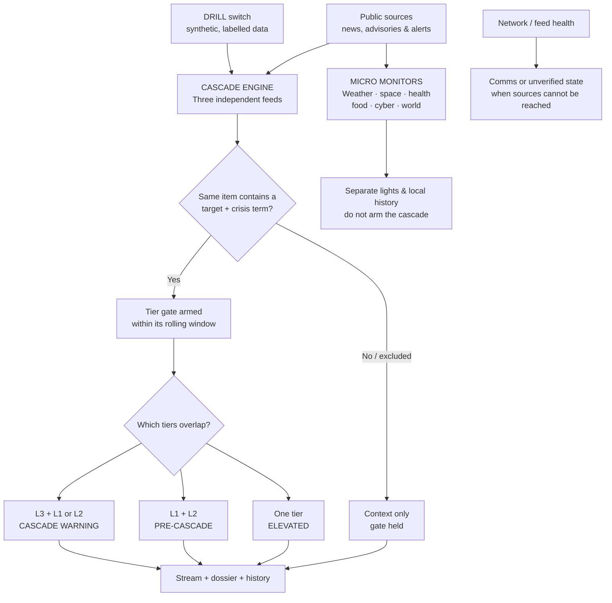

# CASCADE // OPS

### A clearer picture when the signals start to overlap.

**Cascade Ops** is a single-file, browser-based monitoring dashboard for following infrastructure-related news, examining the evidence behind a signal, and looking back through a 60-day view. It combines a three-tier escalation model with independent micro monitors for weather, space weather, health, food safety, cyber, and world news.

Built with the Midwest in mind. Designed to be explored, not blindly trusted.

> **Important:** This is an experimental situational-awareness tool—not an emergency alert system, outage detector, forecasting service, or substitute for official instructions. Its keyword rules can miss important events and flag unrelated stories. A green indicator does **not** guarantee that your family, neighborhood, grid, or communications are safe. Use official alerts and local authorities for decisions that affect safety.

---

## The big picture



The dashboard connects **signals**, not facts about causation. Even a red cascade is a rule-based match in published material—not independent confirmation that an outage or emergency is happening.

## Get moving in a minute

1. Download or clone the repository and open **`index.html`** in a modern browser. No build step, account, or API key is required for the default setup.
2. Hit **SYNC** to retrieve current sources. A fresh install also attempts an initial sync automatically. Check the network and feed indicators rather than assuming it succeeded.
3. Explore the **waterfall** and select an item to open its dossier. Use **Read full source** to try to extract the article into a more readable view, or **Visit original** to open the publisher's page.
4. Click a **micro monitor** to inspect its source, current rule status, and collected history.
5. Use **DRILL** to practice. Drill data is synthetic and labelled; turn it off to hide it and read the cascade using live items only. Turning it off hides drill entries from the stream, related signals, and cascade calculations without deleting them. If a previously selected fictional dossier or a saved brief item remains visible, it is grey and prominently marked **FICTIONAL DRILL · NOT A REAL EVENT**. Exported drill items are labelled as fictional too.

> On a fresh installation, DRILL is on by default. Switch it off before interpreting the cascade as live-only. A mixed live-and-drill view is still a mixed view, even if a live item is present.

## The three-tier cascade

| Tier | Watch | Source | Rolling gate window |
|:---|:---|:---|:---:|
| **L1 · GEO-LOG** | Military and sealift | [USNI News](https://news.usni.org/feed) | 48 hours |
| **L2 · NAT-ICS** | Critical-infrastructure cyber | [CISA Advisories](https://www.cisa.gov/cybersecurity-advisories/all.xml) | 24 hours |
| **L3 · REG-GRID** | Midwest grid context, including MISO / PJM | [Utility Dive](https://www.utilitydive.com/feeds/news/) | 12 hours |

Each tier searches the item’s title and feed text for its configured **target terms** and **crisis terms**. A matching exclusion term suppresses the item before it can count as a match. **MATCH** (previously called “armed”) means both rule terms occur in one item; it does not mean an incident is verified. A target without a crisis term is shown as watch/context; it does not arm the gate. The current lists live in the `TIERS` configuration inside `index.html` and can be inspected or edited there.

| State | Rule of thumb |
|:---|:---|
| **Nominal** | No tier armed and all three feeds answered on the last attempt. |
| **Elevated** | One tier armed—or feeds are degraded while the gate is held. |
| **Pre-cascade** | L1 and L2 are armed within their respective windows. |
| **Cascade warning** | L3 is armed at the same time as L1 or L2. |
| **Comms fault / unverified** | Network or source access is impaired; the display distinguishes a comms problem from higher-level cached evidence that cannot currently be checked. |

**Time matters:** the live cascade uses rolling windows from publication time. The waterfall is a calendar-day history of stored hits, so a day’s color is not a replay of the live rolling-window state at a particular moment.

## Read the lights—not just the headlines

| Signal | What it means |
|:---|:---|
| 🟢 **Green** | A verified feed/status check or no matching rule in the relevant view—not proof of safety. |
| 🟡 **Amber** | A watch, an armed tier, or degraded coverage worth reviewing. |
| 🔴 **Flashing red** | The cascade’s highest rule-based state, or a micro monitor’s highest threshold. Review the actual evidence. |
| 🟣 **Purple** | A communications or source-access problem. Cached information can be stale. |
| 🔴 🟣 **Red / purple** | Higher-level live evidence is present while sources are unavailable; it is unverified. |
| ⚪ **Grey** | No successful check yet or no basis for a determination. |

The network indicator reflects what the **browser reports**, not a comprehensive test of internet connectivity. Feed checks show whether sources answered; they do not validate the truth, completeness, or local relevance of every article. Drill-only events are labelled as such.

## Micro infrastructure monitoring capsules

These small, independent monitors sit above the waterfall. Click any capsule for its source, scope, matching rules, last successful check, and stored entries. Each compact card has ten thin bars: the highest status observed each day on this device, oldest to newest. Grey means no observation, not an all-clear; these are snapshots, not continuous monitoring. They **do not feed the L1/L2/L3 cascade**.

| Capsule | Source | Scope / what it watches |
|:---|:---|:---|
| **Local weather** | [National Weather Service](https://api.weather.gov/alerts/active?zone=INC097) | Active alerts for one selected Midwest county—not the entire Midwest. Severe/extreme alerts or a tornado warning can trigger red. The county is set by the weather source URL in `CAPS`. |
| **Space weather** | [NOAA Space Weather Prediction Center](https://services.swpc.noaa.gov/products/alerts.json) | National/global space-weather products; recent watches, warnings and alerts. G3–G5, S3–S5 or R3–R5 in a product title trigger review. |
| **Health** | [CDC Newsroom](https://tools.cdc.gov/api/v2/resources/media/132608.rss) | National outbreak and public-health-emergency keywords—not local disease surveillance. |
| **Food safety** | [CDC food safety feed](https://tools.cdc.gov/api/v2/resources/media/316422.rss) | National recall and foodborne-illness keywords. |
| **Cyber** | [CISA advisories](https://www.cisa.gov/cybersecurity-advisories/all.xml) | National cyber and infrastructure-related keywords. |
| **World** | [USNI News](https://news.usni.org/feed) | International and national conflict-related keywords. |

For health, food, cyber and world, a recent keyword match is a **watch**; three or more matching items in 24 hours produce a flashing red **review** indicator. Space weather uses the NOAA scale rule in its table row; weather uses the active-alert rule. This is a simple count, not confirmation of an incident, an assessment of local impact, or a prediction. A source failure or a last successful check older than six hours is shown as **COMMS**. The capsules refresh with the main sync or from their own detail window.

**History has limits.** Capsule entries accumulate in this browser as the app successfully checks sources, up to 60 days and a per-capsule storage limit. The dashboard cannot reconstruct items a feed no longer provides or guarantee 60 days on a fresh install. Clearing browser data, using a different browser/device, or blocked storage can remove or prevent local history. Source updates, cancellations, and duplicate reports may not map cleanly to distinct real-world events.

## Explore the evidence

- **Waterfall:** Select a day to inspect its stored items. Step through days using the arrows.
- **Ladder / Chrono / Day:** Group items by tier, scan the stream chronologically, or inspect a day’s slice. Collapse all groups to compact the stream.
- **Dossier:** Select an item to see its source, gate decision, matched terms, feed text, and related signals.
- **Source reader:** Attempts to retrieve and clean the original page into headings, text, tables, and links. It may omit content or fail due to publisher restrictions, paywalls, CORS, or relay availability. Follow the original when you need the authoritative version. Links in the extracted reader ask before opening a new tab.
- **Brief & SITREP:** Collect selected items and export a Markdown situation report.
- **Field manual:** Open the in-app help for the tier terms, controls, and relay settings.

### Keyboard shortcuts

| Key | Action | Key | Action |
|:---:|:---|:---:|:---|
| `1` / `2` / `3` | Focus a tier | `D` | Toggle drill |
| `A` | Chronological stream | `R` | Sync |
| `J` / `K` | Next / previous dossier | `/` | Search |
| `←` / `→` | Step days in day view | `B` | Brief tray |
| `S` | SITREP | `?` | Field manual |
| `Esc` | Close overlays / clear search | | |

## How the data gets here

The application runs in your browser. Main feed sync attempts a configured custom relay first, then public feed-conversion services, with fallback relays if necessary. Public services can throttle, change, or go offline. The independent capsules try direct requests and fallback relay paths; RSS monitors also use public feed converters and, for cyber, an alternate CISA feed. A configured custom relay is also tried by the capsules. The source reader first attempts a direct fetch and may fall back to a public relay. **The source reader does not use the custom relay.** Availability can change or differ between networks, and a failed source remains visibly marked COMMS rather than falsely green.

For more control over main-feed access, open **Field Manual → Relay configuration** and enter a relay URL with `{url}` where the encoded feed URL should go, for example:

```text
https://your-relay.example/?url={url}
```

The relay must return raw feed XML or a supported JSON feed response and allow browser access. Operate and secure your own relay if you need dependable service; do not expose an unrestricted proxy to the public. Publisher terms, access restrictions, and rate limits still apply.

**Privacy and availability:** Archive, preferences, and capsule history are stored locally where browser storage is available. Requests to publishers, feed converters, relays, and optionally remote images expose normal network metadata to those services. The app is not a background notification service: automatic polling is optional and works while the tab is visible; a closed or suspended tab cannot reliably monitor. Sandboxed previews may block network or storage, producing comms errors even when a normal browser can connect.

## Tune it for your mission

Everything is in **`index.html`**:

- Edit `TIERS` to change cascade feeds, rolling windows, target terms, crisis terms, and exclusions.
- Edit `CAPS` and the capsule evaluation code to change independent sources and keyword rules.
- Test changes with known articles and failure cases. A quiet dashboard may reflect a missed keyword or an unavailable source—not an absence of risk.

For real-world preparedness, pair this dashboard with official local alerts, NOAA weather warnings, utility notifications, and other trusted channels. When something looks serious, **open the source, check the date and location, and verify independently**.

---

**CASCADE // OPS** · See the signal. Inspect the evidence. Keep perspective.
